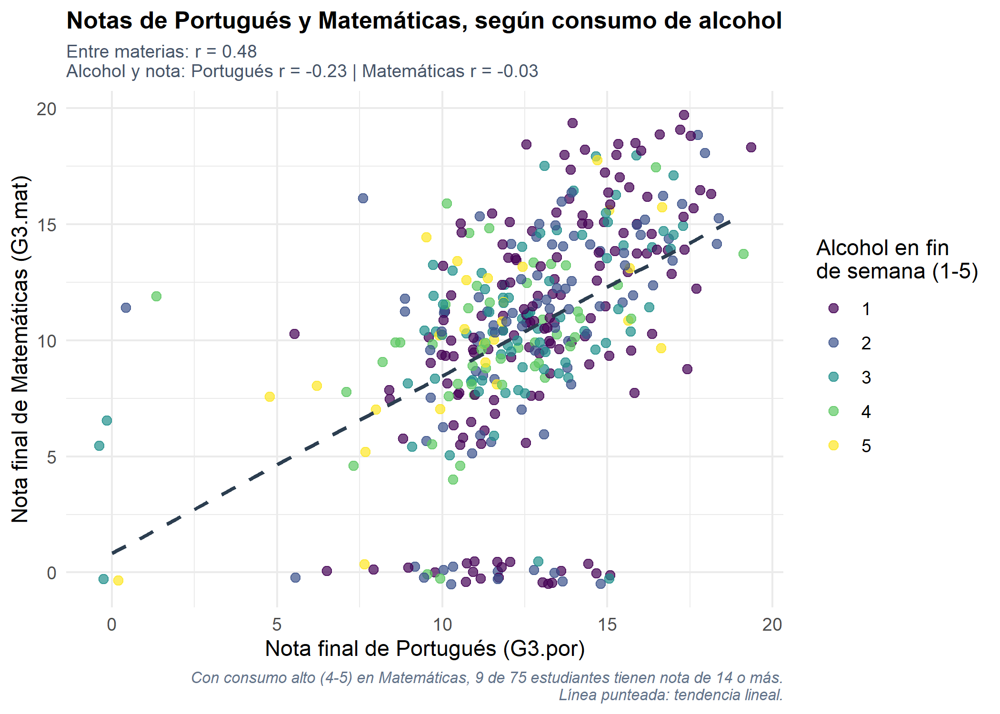
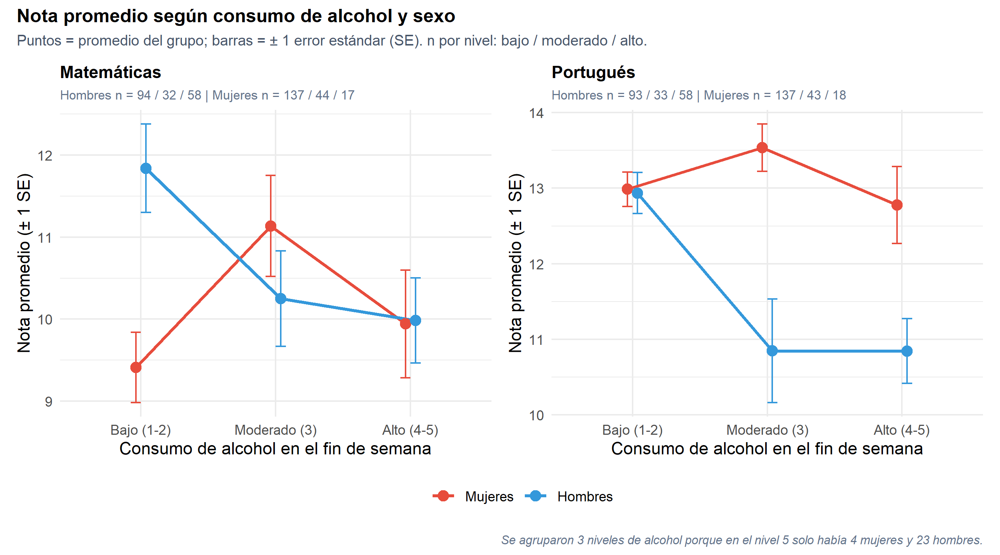
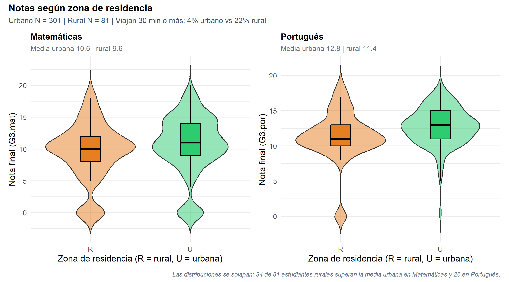
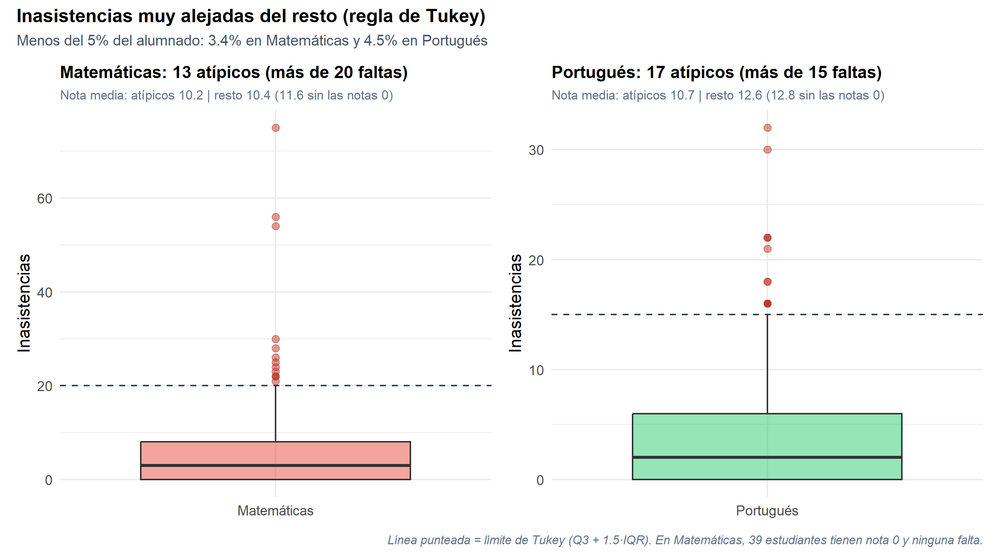

```{r}
#| label: setup
#| include: false
knitr::opts_chunk$set(echo = FALSE, warning = FALSE, message = FALSE)

options(box.path = normalizePath(here::here()))
box::use(
  R / solucion[run_descriptive_pipeline],
  app / pipelines / report_facts[fmt_num]
)

# Every number on the slides comes from the data (same source as the report).
res <- run_descriptive_pipeline(source_kind = "sqlite")
f <- res$facts

minus <- function(x, digits = 1) sub("^-", "−", fmt_num(x, digits))
pct <- function(p, digits = 0) paste0(fmt_num(100 * p, digits), "%")
by_subject <- function(tbl, subject) tbl[tbl$subject == subject, ]
```

## 01. ¿Influye el estilo de vida en las notas?

<div class="meta-bar">
  [\[0:00 - 0:28 | 28s\]]{.time-badge}
  [Tema 3 oficial]{.tag-badge}
  [Cohorte de `r f$cohort$n` estudiantes]{.tag-badge}
  [Límite: 150 segundos]{.tag-badge}
</div>

::::: {.columns}

:::: {.column width="56%"}
::: {.contrast-card}
[Nuestra pregunta]{.text-cyan style="font-size: 1.2em; font-weight: 700; display: block; margin-bottom: 8px;"}

[«¿Cómo se relacionan el **consumo de alcohol** y la **zona de residencia** con las **notas** y las **faltas**, y cambia esto entre **hombres y mujeres**?»]{.lead-p}
:::

::: {.contrast-card-emerald}
[Qué queremos hacer]{.text-emerald style="font-size: 1.2em; font-weight: 700; display: block; margin-bottom: 8px;"}

- **Analizar** cómo se relacionan el alcohol del fin de semana y las notas finales.
- **Comparar** las notas de estudiantes de zona urbana y rural.
- **Identificar** estudiantes con inasistencias muy alejadas del resto (atípicos).
:::
::::

:::: {.column width="44%"}
<div class="stat-grid cols-2">
  <div class="stat"><span class="num text-cyan">`r f$cohort$n`</span><span class="lbl">estudiantes en las dos materias</span></div>
  <div class="stat"><span class="num text-emerald">`r pct(f$cohort$pct_urban)`</span><span class="lbl">vive en zona urbana</span></div>
  <div class="stat"><span class="num text-amber">`r pct(f$cohort$pct_female)`</span><span class="lbl">son mujeres</span></div>
  <div class="stat"><span class="num text-rose">`r fmt_num(f$cohort$mean_age, 1)`</span><span class="lbl">años de edad en promedio</span></div>
</div>

::: {.contrast-card-accent}
[Qué medimos]{.text-amber style="font-size: 1.2em; font-weight: 700; display: block; margin-bottom: 8px;"}

- **Números:** nota final (0 a 20) en cada materia e inasistencias.
- **Categorías:** alcohol del fin de semana (1 = muy bajo, 5 = muy alto), sexo y zona (urbana o rural).
:::
::::

:::::

::: {.notes}
Hola. Analizamos si el estilo de vida se relaciona con las notas, con datos de 382 estudiantes de dos colegios de Portugal que cursan Matemáticas y Portugués. Nuestra pregunta: ¿cómo se relacionan el consumo de alcohol y la zona de residencia con las notas y las faltas, y cambia esto entre hombres y mujeres?
:::

---

## 02. Cómo unimos las dos asignaturas

<div class="meta-bar">
  [\[0:28 - 0:50 | 22s\]]{.time-badge}
  [Método de Cortez & Silva (2008)]{.tag-badge}
  [Análisis reproducible en R]{.tag-badge}
</div>

[Para comparar de forma justa, miramos al mismo perfil de estudiante en las dos materias.]{.lead-p}

<div class="stat-grid cols-3">
  <div class="stat"><span class="num text-cyan">13</span><span class="lbl">datos que se repiten entre estudiantes</span></div>
  <div class="stat"><span class="num text-emerald">`r f$cohort$n`</span><span class="lbl">perfiles presentes en ambas materias</span></div>
  <div class="stat"><span class="num text-amber">2</span><span class="lbl">materias observadas por perfil</span></div>
</div>

::::: {.columns}

:::: {.column width="33%"}
::: {.contrast-card style="min-height: 400px;"}
[1. Cómo se unieron]{.text-cyan style="font-size: 1.15em; font-weight: 700; display: block; margin-bottom: 8px;"}

- Colegio, sexo, edad y zona.
- Tamaño y situación de la familia.
- Estudios y trabajo de los padres.
- Motivo de elección del colegio, guardería previa e internet.
:::
::::

:::: {.column width="34%"}
::: {.contrast-card-emerald style="min-height: 400px;"}
[2. Qué ganamos]{.text-emerald style="font-size: 1.15em; font-weight: 700; display: block; margin-bottom: 8px;"}

- Cada perfil se ve en Matemáticas **y** en Portugués.
- La comparación es más justa: los datos de colegio y de familia coinciden en ambas materias.
:::
::::

:::: {.column width="33%"}
::: {.contrast-card-accent style="min-height: 400px;"}
[3. Qué debemos recordar]{.text-amber style="font-size: 1.15em; font-weight: 700; display: block; margin-bottom: 8px;"}

- Es una coincidencia de perfil, **no** un código único de persona.
- Hablamos de **asociaciones**, no de causas.
:::
::::

:::::

::: {.notes}
Para comparar de forma justa, unimos las dos asignaturas usando trece datos que se repiten entre estudiantes, como edad, sexo, zona y estudios de los padres. Así vemos a un mismo perfil en ambas materias. Importante: es una coincidencia de perfil, no un código único de persona.
:::

---

## 03. Las notas van de la mano; el alcohol se asocia poco

<div class="meta-bar">
  [\[0:50 - 1:14 | 24s\]]{.time-badge}
  [Dispersión de notas]{.tag-badge}
  [Correlación (r)]{.tag-badge}
</div>

::::: {.columns}

:::: {.column width="52%"}
::: {.plot-frame}
{alt="Notas de Portugués y Matemáticas según consumo de alcohol"}
:::
::::

:::: {.column width="48%"}
<div class="stat-grid cols-3">
  <div class="stat"><span class="num text-cyan">`r fmt_num(f$corr$subjects$pearson, 2)`</span><span class="lbl">entre materias: moderada y positiva</span></div>
  <div class="stat"><span class="num text-amber">`r minus(f$corr$alcohol_por$pearson, 2)`</span><span class="lbl">alcohol y nota en Portugués: débil</span></div>
  <div class="stat"><span class="num text-emerald">`r minus(f$corr$alcohol_mat$pearson, 2)`</span><span class="lbl">alcohol y nota en Matemáticas: casi nula</span></div>
</div>

<div class="stat-grid cols-2">
  <div class="stat"><span class="num text-amber">`r f$high_alcohol$mat$n_good` de `r f$high_alcohol$mat$n_high`</span><span class="lbl">con alcohol alto (4-5) tienen nota de 14 o más en Matemáticas (`r pct(f$high_alcohol$mat$pct_good)`)</span></div>
  <div class="stat"><span class="num text-amber">`r f$high_alcohol$por$n_good` de `r f$high_alcohol$por$n_high`</span><span class="lbl">con alcohol alto (4-5) tienen nota de 14 o más en Portugués (`r pct(f$high_alcohol$por$pct_good)`)</span></div>
</div>

::: {.takeaway}
[Qué significa]{.k}

Quien va bien en una materia suele ir bien en la otra. El alcohol, por sí solo, dice poco sobre la nota de un estudiante.
:::

<p class="note-line">r va de −1 a 1; cuanto más cerca de 0, más débil la relación. Con Spearman (para escalas ordenadas): `r fmt_num(f$corr$subjects$spearman, 2)`, `r minus(f$corr$alcohol_por$spearman, 2)` y `r minus(f$corr$alcohol_mat$spearman, 2)`.</p>
::::

:::::

::: {.notes}
Las notas de ambas materias van de la mano: la correlación es de casi cero coma cinco, moderada. El alcohol, en cambio, se asocia poco con las notas: en Portugués la relación es débil y en Matemáticas casi nula. Y hay estudiantes con consumo alto y notas de catorce o más.
:::

---

## 04. Alcohol, sexo y notas

<div class="meta-bar">
  [\[1:14 - 1:36 | 22s\]]{.time-badge}
  [Promedios por grupo (± 1 SE)]{.tag-badge}
  [3 niveles de alcohol]{.tag-badge}
</div>

::::: {.columns}

:::: {.column width="52%"}
::: {.plot-frame}
{alt="Nota promedio según consumo de alcohol y sexo"}
:::
::::

:::: {.column width="48%"}
```{r}
#| output: asis
strata <- f$strata
cell <- function(subject, sex, level) {
  keep <- strata$subject == subject & strata$sex == sex &
    strata$stratum == level
  r <- strata[keep, ]
  cls <- if (subject == "por" && sex == "M" && level != "Bajo (1-2)") {
    " class=\"hl\""
  } else {
    ""
  }
  sprintf("<td%s>%s <small>(n = %d)</small></td>", cls, fmt_num(r$mean), r$n)
}
row <- function(subject, sex, label) {
  cells <- vapply(levels(strata$stratum), function(l) cell(subject, sex, l), "")
  sprintf("<tr><th>%s</th>%s</tr>", label, paste(cells, collapse = ""))
}
cat(
  "<table class=\"mini-table\"><thead><tr><th>Nota promedio</th>",
  paste0("<th>", levels(strata$stratum), "</th>", collapse = ""),
  "</tr></thead><tbody>",
  row("por", "M", "Portugués · hombres"),
  row("por", "F", "Portugués · mujeres"),
  row("mat", "M", "Matemáticas · hombres"),
  row("mat", "F", "Matemáticas · mujeres"),
  "</tbody></table>",
  sep = ""
)
```

<div class="stat-grid cols-2">
  <div class="stat"><span class="num text-cyan">`r f$walc5_by_sex[["F"]]` vs `r f$walc5_by_sex[["M"]]`</span><span class="lbl">mujeres vs hombres con alcohol nivel 5: por eso agrupamos en 3 niveles</span></div>
  <div class="stat"><span class="num text-rose">`r pct(f$women_low_moderate)`</span><span class="lbl">de las mujeres está en consumo bajo o moderado</span></div>
</div>

::: {.takeaway}
[Qué significa]{.k}

En Portugués, el promedio de los hombres baja al pasar de consumo bajo a moderado y luego se mantiene; el de las mujeres queda cerca de 13. En Matemáticas los hombres también bajan y las mujeres no siguen un patrón claro. Hay pocas mujeres con consumo alto: interpretar con cautela.
:::
::::

:::::

::: {.notes}
Agrupamos el alcohol en tres niveles. En Portugués, el promedio de los hombres baja de trece a once al pasar de consumo bajo a moderado y ahí se queda; el de las mujeres se mantiene cerca de trece. En Matemáticas los hombres también bajan; las mujeres, sin patrón claro.
:::

---

## 05. Zona urbana y zona rural

<div class="meta-bar">
  [\[1:36 - 1:53 | 17s\]]{.time-badge}
  [Violín + caja]{.tag-badge}
  [Diferencia de promedios con IC 95%]{.tag-badge}
</div>

::::: {.columns}

:::: {.column width="52%"}
::: {.plot-frame}
{alt="Notas según zona de residencia"}
:::
::::

:::: {.column width="48%"}
```{r}
#| output: asis
gap_row <- function(subject, label) {
  g <- by_subject(f$address, subject)
  clear <- g$ci_high < 0 || g$ci_low > 0
  sprintf(
    paste0(
      "<tr><th>%s</th><td>%s</td><td>%s</td>",
      "<td%s>%s <small>(IC 95%%: %s a %s)</small></td></tr>"
    ),
    label, fmt_num(g$mean_urban), fmt_num(g$mean_rural),
    if (clear) " class=\"hl\"" else "",
    minus(g$diff), minus(g$ci_low), minus(g$ci_high)
  )
}
cat(
  "<table class=\"mini-table\"><thead><tr><th>Nota promedio</th>",
  "<th>Urbano</th><th>Rural</th><th>Diferencia (rural − urbano)</th>",
  "</tr></thead><tbody>",
  gap_row("mat", "Matemáticas"),
  gap_row("por", "Portugués"),
  "</tbody></table>",
  sep = ""
)
```

<div class="stat-grid cols-3">
  <div class="stat"><span class="num sm text-cyan">`r by_subject(f$address, "mat")$n_urban` vs `r by_subject(f$address, "mat")$n_rural`</span><span class="lbl">estudiantes urbanos vs rurales</span></div>
  <div class="stat"><span class="num sm text-amber">`r pct(f$long_travel[["rural"]])` vs `r pct(f$long_travel[["urban"]])`</span><span class="lbl">rurales vs urbanos que viajan 30 min o más</span></div>
  <div class="stat"><span class="num sm text-emerald">`r by_subject(f$address, "mat")$rural_above_urban` y `r by_subject(f$address, "por")$rural_above_urban`</span><span class="lbl">de `r by_subject(f$address, "mat")$n_rural` rurales superan la media urbana (Mat. y Por.)</span></div>
</div>

::: {.takeaway}
[Qué significa]{.k}

En Portugués la diferencia es clara: el intervalo no incluye el 0. En Matemáticas es incierta: el intervalo sí incluye el 0. Además, las notas de ambas zonas se solapan mucho.
:::

<p class="note-line">IC 95%: rango de valores razonables para la diferencia real entre zonas. Viaje de 30 min o más = códigos 3 y 4 de `traveltime` (escala 1 a 4).</p>
::::

:::::

::: {.notes}
Los estudiantes rurales tienen notas promedio más bajas: un punto en Matemáticas, aunque incierto, y uno coma cuatro en Portugués. Además, uno de cada cinco viaja media hora o más. Aun así, muchos rurales superan el promedio urbano.
:::

---

## 06. Inasistencias muy alejadas del resto

<div class="meta-bar">
  [\[1:53 - 2:10 | 17s\]]{.time-badge}
  [Regla de Tukey (IQR)]{.tag-badge}
  [Atípicos en faltas]{.tag-badge}
</div>

::::: {.columns}

:::: {.column width="52%"}
::: {.plot-frame}
{alt="Inasistencias muy alejadas del resto según la regla de Tukey"}
:::
::::

:::: {.column width="48%"}
<p class="note-line" style="font-size: 0.8em;"><b>Atípico</b> = valor muy alejado del resto. La <b>regla de Tukey</b> es una forma estándar de detectarlos: más de Q3 + 1.5·IQR.</p>

```{r}
#| output: asis
abs_row <- function(subject, label) {
  a <- by_subject(f$absences, subject)
  sprintf(
    paste0(
      "<tr><th>%s</th><td>%d</td><td>%d <small>(%s)</small></td>",
      "<td>%d</td><td>%s → %s</td></tr>"
    ),
    label, as.integer(a$upper), a$n_out, pct(a$pct_out, 1),
    as.integer(a$max_absences), fmt_num(a$mean_out), fmt_num(a$mean_rest)
  )
}
cat(
  "<table class=\"mini-table\"><thead><tr><th></th><th>Límite (faltas)</th>",
  "<th>Atípicos</th><th>Máximo</th><th>Nota media: atípicos → resto</th>",
  "</tr></thead><tbody>",
  abs_row("mat", "Matemáticas"),
  abs_row("por", "Portugués"),
  "</tbody></table>",
  sep = ""
)
```

<div class="stat-grid cols-2">
  <div class="stat"><span class="num text-rose">`r minus(by_subject(f$absences, "por")$diff)`</span><span class="lbl">puntos: nota de los atípicos en Portugués (IC 95%: `r minus(by_subject(f$absences, "por")$ci_low)` a `r minus(by_subject(f$absences, "por")$ci_high)`)</span></div>
  <div class="stat"><span class="num text-amber">`r by_subject(f$absences, "mat")$n_zero_no_absences`</span><span class="lbl">estudiantes con nota 0 y ninguna falta en Matemáticas</span></div>
</div>

::: {.takeaway}
[Qué significa]{.k}

Menos del 5% de los estudiantes falta muy por encima del resto. En Portugués, ellos tienen notas más bajas. En Matemáticas los ceros bajan el promedio del resto (sin ellos: `r fmt_num(by_subject(f$absences, "mat")$mean_rest_nonzero)` vs `r fmt_num(by_subject(f$absences, "mat")$mean_out)`), y con solo `r by_subject(f$absences, "mat")$n_out` casos la comparación es incierta.
:::
::::

:::::

::: {.notes}
Con la regla de Tukey, detectamos faltas muy alejadas del resto: trece estudiantes en Matemáticas y diecisiete en Portugués. En Portugués sus notas son casi dos puntos menores; en Matemáticas, los ceros complican la comparación.
:::

---

## 07. Conclusiones: qué aprendimos y qué cuidar

<div class="meta-bar">
  [\[2:10 - 2:30 | 20s\]]{.time-badge}
  [Hallazgo → significado → cuidado]{.tag-badge}
  [Asociaciones, no causas]{.tag-badge}
</div>

::::: {.columns}

:::: {.column width="33%"}
::: {.contrast-card style="min-height: 640px;"}
[1. Alcohol y notas]{.text-cyan style="font-size: 1.15em; font-weight: 700; display: block; margin-bottom: 4px;"}

[r = `r minus(f$corr$alcohol_por$pearson, 2)` (Por.) · `r minus(f$corr$alcohol_mat$pearson, 2)` (Mat.)]{.text-cyan style="font-size: 1.2em; font-weight: 800; display: block; margin-bottom: 8px;"}

<p class="finding"><span class="k">Hallazgo</span>En Portugués, más alcohol va de la mano de notas algo más bajas, sobre todo en hombres. En Matemáticas, casi nada.</p>
<p class="finding"><span class="k">Qué significa</span>El alcohol por sí solo dice poco sobre la nota de un estudiante.</p>
<p class="finding"><span class="k">Cuidado</span>Es una asociación, no una causa; hay pocas mujeres con consumo alto.</p>
:::
::::

:::: {.column width="34%"}
::: {.contrast-card-emerald style="min-height: 640px;"}
[2. Zona rural]{.text-emerald style="font-size: 1.15em; font-weight: 700; display: block; margin-bottom: 4px;"}

[`r minus(by_subject(f$address, "por")$diff)` pts en Portugués]{.text-emerald style="font-size: 1.2em; font-weight: 800; display: block; margin-bottom: 8px;"}

<p class="finding"><span class="k">Hallazgo</span>Los rurales promedian `r fmt_num(abs(by_subject(f$address, "por")$diff))` puntos menos en Portugués; en Matemáticas la diferencia es incierta. `r pct(f$long_travel[["rural"]])` viaja 30 min o más, frente a `r pct(f$long_travel[["urban"]])` urbano.</p>
<p class="finding"><span class="k">Qué significa</span>Puede haber barreras de acceso, pero muchos rurales superan el promedio urbano.</p>
<p class="finding"><span class="k">Cuidado</span>Un modelo de IA no debería usar la zona para etiquetar a nadie.</p>
:::
::::

:::: {.column width="33%"}
::: {.contrast-card-accent style="min-height: 640px;"}
[3. Faltas muy altas]{.text-amber style="font-size: 1.15em; font-weight: 700; display: block; margin-bottom: 4px;"}

[`r by_subject(f$absences, "mat")$n_out` y `r by_subject(f$absences, "por")$n_out` estudiantes]{.text-amber style="font-size: 1.2em; font-weight: 800; display: block; margin-bottom: 8px;"}

<p class="finding"><span class="k">Hallazgo</span>Son menos del 5% del alumnado. En Portugués, sus notas son `r fmt_num(abs(by_subject(f$absences, "por")$diff))` puntos menores.</p>
<p class="finding"><span class="k">Qué significa</span>Es un grupo pequeño al que conviene acompañar.</p>
<p class="finding"><span class="k">Cuidado</span>Los `r by_subject(f$absences, "mat")$n_zero` ceros de Matemáticas distorsionan la comparación.</p>
:::
::::

:::::

::: {style="text-align: center; margin-top: 6px;"}
[¡Muchas gracias! • Juan Nicolás Patiño Rodríguez]{.tag-badge style="font-size: 0.9em; padding: 8px 24px;"}
:::

::: {.notes}
En resumen: el alcohol se asocia con notas más bajas, sobre todo en hombres en Portugués. La brecha rural es clara en Portugués y menos en Matemáticas. Son asociaciones, no causas: sirven para orientar apoyos, y cualquier modelo de IA debe usarlas con cuidado. Gracias.
:::
