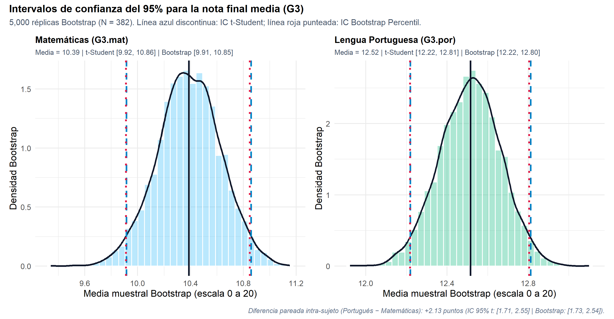
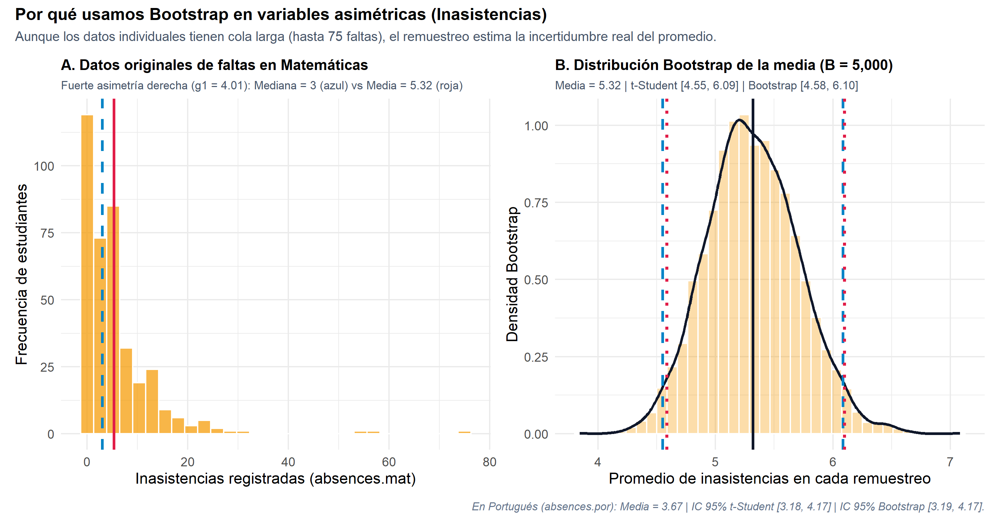
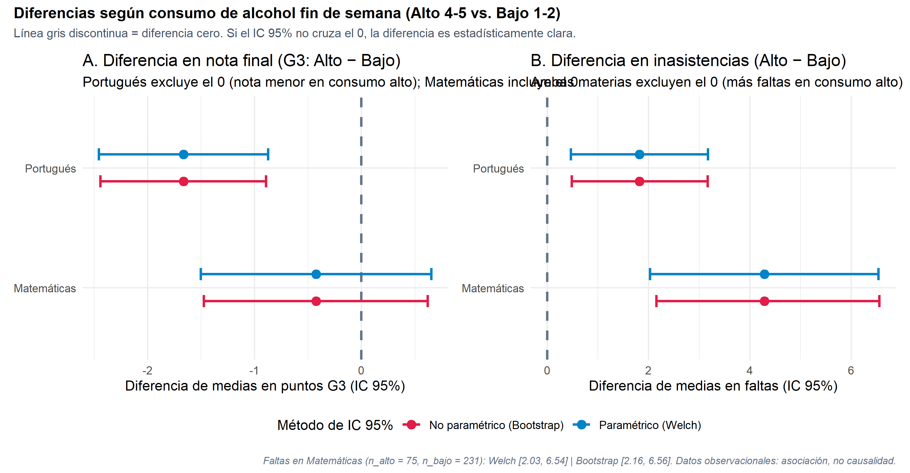
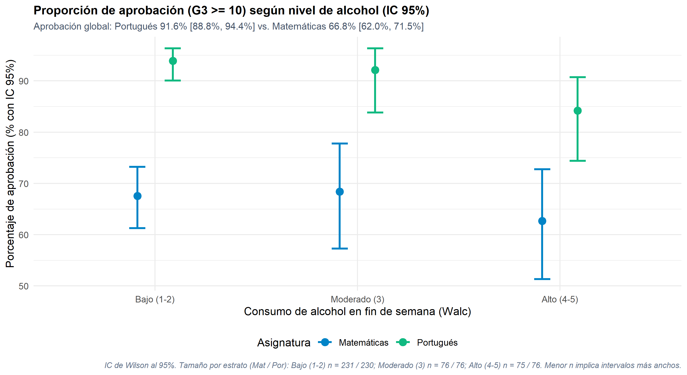

```{r}
#| label: setup
#| include: false
knitr::opts_chunk$set(echo = FALSE, warning = FALSE, message = FALSE)

options(box.path = normalizePath(here::here()))
box::use(
  R / solucion[run_inferential_pipeline],
  app / pipelines / inferential_facts[fmt_num, fmt_ci]
)

res <- run_inferential_pipeline(
  source_kind = "sqlite",
  n_boot = 5000L,
  seed = 2026L
)
f <- res$facts
u <- f$univariate
abs_mat_boot_se <- f$univariate_table$boot_se[
  f$univariate_table$variable == "absences.mat"
]
c_alc <- f$contrasts$alcohol
pr <- f$proportions

minus <- function(x, digits = 2) sub("^-", "−", fmt_num(x, digits))
pct <- function(p, digits = 1) paste0(fmt_num(100 * p, digits), "%")
```

## 01. De la descripción a la inferencia: las 3 variables

<div class="meta-bar">
  [\[0:00 - 0:22 | 22s\]]{.time-badge}
  [Continuidad Tema 3]{.tag-badge}
  [Cohorte pareada N = `r f$cohort$n`]{.tag-badge}
  [Duración objetivo: 2:30 min (150s)]{.tag-badge}
</div>

::::: {.columns}

:::: {.column width="56%"}
::: {.contrast-card}
[Problema inferencial]{.text-cyan style="font-size: 1.2em; font-weight: 700; display: block; margin-bottom: 8px;"}

[«Un promedio muestral cambia de muestra en muestra. ¿Entre qué **rangos del 95% de confianza** están las verdaderas medias y proporciones poblacionales en nuestras **3 variables** (`G3`, `absences`, `Walc`), y qué diferencias excluyen realmente el **cero**?»]{.lead-p}
:::

::: {.contrast-card-emerald}
[Por qué comparar dos enfoques]{.text-emerald style="font-size: 1.2em; font-weight: 700; display: block; margin-bottom: 8px;"}

- **Paramétrico ($t$-Student, Welch, Wald/Wilson):** fiable cuando la media se distribuye casi normal (simetría o $n$ grande).
- **No paramétrico (Bootstrap Percentil):** remuestrea los datos reales sin asumir normalidad; sirve para verificar al clásico ante la fuerte asimetría de las inasistencias.
:::
::::

:::: {.column width="44%"}
<div class="stat-grid cols-2">
  <div class="stat"><span class="num text-cyan">`r f$cohort$n`</span><span class="lbl">perfiles en Matemáticas y Portugués</span></div>
  <div class="stat"><span class="num text-emerald">`r pct(f$cohort$conf_level, 0)`</span><span class="lbl">nivel de confianza frecuentista</span></div>
  <div class="stat"><span class="num text-amber">`r format(f$cohort$n_boot, big.mark = ",")`</span><span class="lbl">réplicas Bootstrap (semilla 2026)</span></div>
  <div class="stat"><span class="num text-rose">3</span><span class="lbl">variables: Notas, Faltas y Alcohol</span></div>
</div>

::: {.contrast-card-accent}
[Principio clave]{.text-amber style="font-size: 1.2em; font-weight: 700; display: block; margin-bottom: 8px;"}

- El **95% de confianza** describe al procedimiento aleatorio de intervalos que captura al parámetro fijo $\mu$, y en contrastes $\mu_1 - \mu_2$ evaluamos si el intervalo **excluye el 0**.
:::
::::

:::::

::: {.notes}
Hola. Seguimos con los 382 estudiantes que cursan Matemáticas y Portugués. En la Unidad 2 vimos notas más altas en Portugués y faltas muy asimétricas. Hoy preguntamos: ¿qué podemos afirmar de toda la población, con 95% de confianza, sobre notas, faltas y consumo de alcohol?
:::

---

## 02. Intervalos del 95% para las medias de las 3 variables

<div class="meta-bar">
  [\[0:22 - 0:54 | 32s\]]{.time-badge}
  [t-Student vs. Bootstrap Percentil]{.tag-badge}
  [Lectura guiada: Convergencia y precisión]{.tag-badge}
</div>

::::: {.columns}

:::: {.column width="52%"}
::: {.plot-frame}
{alt="Intervalos de confianza del 95% para medias poblacionales"}
:::
::::

:::: {.column width="48%"}
```{r}
#| output: asis
uni_row <- function(label, obj, hl = FALSE) {
  cls <- if (hl) " class=\"hl\"" else ""
  sprintf(
    paste0(
      "<tr><th>%s</th><td>%s</td>",
      "<td%s>[%s, %s]</td><td%s>[%s, %s]</td></tr>"
    ),
    label,
    fmt_num(obj$mean, 2),
    cls, fmt_num(obj$t_low, 2), fmt_num(obj$t_high, 2),
    cls, fmt_num(obj$boot_low, 2), fmt_num(obj$boot_high, 2)
  )
}
cat(
  "<table class=\"mini-table\"><thead><tr><th>Variable (N = 382)</th>",
  "<th>Media</th><th>IC 95% t-Student</th><th>IC 95% Bootstrap</th>",
  "</tr></thead><tbody>",
  uni_row("Nota Matemáticas (G3.mat)", u$g3_mat),
  uni_row("Nota Portugués (G3.por)", u$g3_por, TRUE),
  uni_row("Faltas Matemáticas (abs.mat)", u$abs_mat, TRUE),
  uni_row("Faltas Portugués (abs.por)", u$abs_por),
  uni_row("Alcohol fin de semana (Walc)", u$walc),
  "</tbody></table>",
  sep = ""
)
```

<div class="stat-grid cols-2">
  <div class="stat"><span class="num text-emerald">+`r fmt_num(f$paired_g3$mean, 2)` pts</span><span class="lbl">ventaja pareada en Portugués vs. Matemáticas (IC 95%: `r fmt_ci(f$paired_g3$t_low, f$paired_g3$t_high, 2)`)</span></div>
  <div class="stat"><span class="num text-cyan">±`r fmt_num(u$g3_por$t_half, 2)` vs ±`r fmt_num(u$g3_mat$t_half, 2)`</span><span class="lbl">semiamplitud del IC en Portugués vs. Matemáticas</span></div>
</div>

::: {.takeaway}
[Cómo leer esta gráfica y qué nos revela]{.k}

Cada histograma muestra las 5,000 medias Bootstrap (**celeste**: Matemáticas; **verde**: Portugués). La **línea negra** es la media muestral; las **azules discontinuas** ($t$-Student) y **rojas punteadas** (Bootstrap) casi se superponen porque con $n = `r f$cohort$n`$ la media es aproximadamente normal. El IC de Portugués (`r fmt_ci(u$g3_por$t_low, u$g3_por$t_high, 2)`) es más angosto que el de Matemáticas (`r fmt_ci(u$g3_mat$t_low, u$g3_mat$t_high, 2)`) por su menor dispersión (DE `r fmt_num(u$g3_por$sd, 2)` vs. `r fmt_num(u$g3_mat$sd, 2)`).
:::
::::

:::::

::: {.notes}
En esta gráfica, cada histograma reúne 5.000 medias simuladas por Bootstrap. La línea azul, del método clásico, y la roja, del Bootstrap, casi coinciden porque la muestra es grande. Con 95% de confianza, la nota media va de 9.9 a 10.9 en Matemáticas y de 12.2 a 12.8 en Portugués. Y comparando a cada estudiante consigo mismo, Portugués supera por unos 2 puntos.
:::

---

## 03. Asimetría en inasistencias: ¿cambia la conclusión con Bootstrap?

<div class="meta-bar">
  [\[0:54 - 1:25 | 31s\]]{.time-badge}
  [Asimetría positiva extrema]{.tag-badge}
  [Lectura guiada: Panel A (datos crudos) vs. Panel B (remuestreo)]{.tag-badge}
</div>

::::: {.columns}

:::: {.column width="52%"}
::: {.plot-frame}
{alt="Distribución Bootstrap de la media de inasistencias"}
:::
::::

:::: {.column width="48%"}
<div class="stat-grid cols-3">
  <div class="stat"><span class="num text-amber">`r fmt_num(u$abs_mat$skewness, 2)`</span><span class="lbl">asimetría en faltas de Matemáticas (cola hasta 75)</span></div>
  <div class="stat"><span class="num text-cyan">`r fmt_num(u$abs_por$skewness, 2)`</span><span class="lbl">asimetría en faltas de Portugués</span></div>
  <div class="stat"><span class="num sm text-emerald">`r fmt_num(u$abs_mat$se, 3)` vs `r fmt_num(abs_mat_boot_se, 3)`</span><span class="lbl">error estándar de la media: t vs. Bootstrap (Mat.)</span></div>
</div>

<div class="stat-grid cols-2">
  <div class="stat"><span class="num sm text-cyan">`r fmt_ci(u$abs_mat$t_low, u$abs_mat$t_high, 3)`</span><span class="lbl">IC 95% t-Student en faltas de Matemáticas</span></div>
  <div class="stat"><span class="num sm text-emerald">`r fmt_ci(u$abs_mat$boot_low, u$abs_mat$boot_high, 3)`</span><span class="lbl">IC 95% Bootstrap Percentil en faltas de Matemáticas</span></div>
</div>

::: {.takeaway}
[Cómo leer esta gráfica y qué nos revela]{.k}

En el **Panel A (izquierda)** la cola de hasta 75 faltas separa la **media (roja: `r fmt_num(u$abs_mat$mean, 2)`)** de la **mediana (azul: `r fmt_num(u$abs_mat$median, 0)`)**. En el **Panel B (derecha)**, por el Teorema Central del Límite las medias remuestreadas forman una campana: las **líneas rojas (Bootstrap)** y **azules ($t$-Student)** difieren solo en centésimas. Con $n = `r f$cohort$n`$, la asimetría no invalida el IC clásico: el Bootstrap lo **confirma**.
:::
::::

:::::

::: {.notes}
Las faltas son el caso exigente. A la izquierda, la mayoría falta poco, pero algunos llegan a 75, y eso separa la media, 5.3, de la mediana, 3. A la derecha, por el Teorema Central del Límite, las medias remuestreadas forman una campana y ambos intervalos coinciden: entre 4.6 y 6.1 faltas. El Bootstrap confirma que el método clásico sigue siendo confiable.
:::

---

## 04. Contrastes por alcohol: el valor de mirar las 3 variables

<div class="meta-bar">
  [\[1:25 - 1:56 | 31s\]]{.time-badge}
  [Alcohol Alto (4-5) vs. Bajo (1-2)]{.tag-badge}
  [Lectura guiada: La línea vertical del cero]{.tag-badge}
</div>

::::: {.columns}

:::: {.column width="52%"}
::: {.plot-frame}
{alt="Diferencia de medias entre consumo de alcohol alto y bajo"}
:::
::::

:::: {.column width="48%"}
```{r}
#| output: asis
c_row <- function(label, obj) {
  cls <- if (obj$excludes_zero) " class=\"hl\"" else ""
  verdict <- if (obj$excludes_zero) {
    "Excluye 0 (clara)"
  } else {
    "Incluye 0 (no concluyente)"
  }
  sprintf(
    paste0(
      "<tr><th>%s</th><td%s>%s</td>",
      "<td%s>[%s, %s]</td><td>%s</td></tr>"
    ),
    label,
    cls, minus(obj$diff, 2),
    cls, minus(obj$welch_low, 2), minus(obj$welch_high, 2),
    verdict
  )
}
cat(
  "<table class=\"mini-table\"><thead><tr><th>Contraste (Alto − Bajo)</th>",
  "<th>Dif.</th><th>IC 95% Welch</th><th>Conclusión</th>",
  "</tr></thead><tbody>",
  c_row("Nota Portugués (G3.por)", c_alc$g3_por),
  c_row("Nota Matemáticas (G3.mat)", c_alc$g3_mat),
  c_row("Faltas Matemáticas (abs.mat)", c_alc$abs_mat),
  c_row("Faltas Portugués (abs.por)", c_alc$abs_por),
  "</tbody></table>",
  sep = ""
)
```

<div class="stat-grid cols-2">
  <div class="stat"><span class="num text-rose">`r minus(c_alc$g3_por$diff, 2)` pts</span><span class="lbl">diferencia en nota de Portugués, alto − bajo (`r fmt_ci(c_alc$g3_por$boot_low, c_alc$g3_por$boot_high, 2)` Boot)</span></div>
  <div class="stat"><span class="num text-amber">+`r fmt_num(c_alc$abs_mat$diff, 2)` faltas</span><span class="lbl">faltas adicionales en Matemáticas, alto − bajo (`r fmt_ci(c_alc$abs_mat$boot_low, c_alc$abs_mat$boot_high, 2)` Boot)</span></div>
</div>

::: {.takeaway}
[Cómo leer esta gráfica y qué nos revela]{.k}

La clave es la **línea gris discontinua en el cero**: si el intervalo (**azul**: Welch; **rojo**: Bootstrap) **cruza el $0$**, la diferencia no es concluyente (nota en Matemáticas: `r fmt_ci(c_alc$g3_mat$welch_low, c_alc$g3_mat$welch_high, 2)`). Si queda **de un solo lado**, la diferencia es estadísticamente clara: nota en Portugués (`r minus(c_alc$g3_por$diff, 2)`) y faltas en ambas materias (+`r fmt_num(c_alc$abs_mat$diff, 2)` y +`r fmt_num(c_alc$abs_por$diff, 2)`). Datos observacionales: **asociación, no causalidad**.
:::
::::

:::::

::: {.notes}
Ahora, alcohol alto frente a bajo. Miren la línea gris del cero: si el intervalo la cruza, la diferencia podría ser azar; si no la toca, es clara. En Matemáticas la nota cruza el cero: no es concluyente. En Portugués, quienes beben más tienen 1.7 puntos menos, y faltan más: 4.3 faltas en Matemáticas y 1.8 en Portugués. Son asociaciones, no causas.
:::

---

## 05. Aprobación, límites y aplicaciones

<div class="meta-bar">
  [\[1:56 - 2:30 | 34s\]]{.time-badge}
  [Proporciones (Wald / Wilson)]{.tag-badge}
  [Lectura guiada: Brecha de aprobación y tamaño de cada grupo]{.tag-badge}
</div>

::::: {.columns}

:::: {.column width="52%"}
::: {.plot-frame}
{alt="Proporciones de aprobación con IC 95%"}
:::
::::

:::: {.column width="48%"}
<div class="stat-grid cols-3">
  <div class="stat"><span class="num text-emerald">`r pct(pr$pass_por$prop, 1)`</span><span class="lbl">aprueba Portugués (`r pct(pr$pass_por$wald_low, 1)` a `r pct(pr$pass_por$wald_high, 1)`)</span></div>
  <div class="stat"><span class="num text-cyan">`r pct(pr$pass_mat$prop, 1)`</span><span class="lbl">aprueba Matemáticas (`r pct(pr$pass_mat$wald_low, 1)` a `r pct(pr$pass_mat$wald_high, 1)`)</span></div>
  <div class="stat"><span class="num text-amber">`r minus(100 * pr$diff_pass$diff, 1)` pp</span><span class="lbl">brecha de aprobación Mat − Por</span></div>
</div>

::: {.contrast-card}
[1. Cómo leer el gráfico de aprobación (`G3 >= 10`)]{.text-cyan style="font-size: 1.08em; font-weight: 700; display: block; margin-bottom: 4px;"}

Los intervalos **verdes (Portugués)** y **azules (Matemáticas)** no se tocan en ningún nivel de alcohol. Los grupos moderado y alto ($n \approx 75$ cada uno, frente a $\approx 230$ en bajo) tienen intervalos de Wilson más anchos.
:::

::: {.contrast-card-emerald}
[2. Límites del estudio]{.text-emerald style="font-size: 1.08em; font-weight: 700; display: block; margin-bottom: 4px;"}

Dos colegios portugueses; solo estudiantes que cursan ambas materias; alcohol autorreportado; un único corte en el tiempo. Son asociaciones, no efectos causales, y no se generalizan sin cautela.
:::

::: {.contrast-card-accent}
[3. Aplicaciones]{.text-amber style="font-size: 1.08em; font-weight: 700; display: block; margin-bottom: 4px;"}

Reforzar tutorías en Matemáticas (1 de cada 3 no aprueba) y vigilar el ausentismo, que es mayor en el grupo de consumo alto.
:::
::::

:::::

::: {.notes}
Por último, aprobar con 10 o más: 92% en Portugués frente a 67% en Matemáticas, y en ningún nivel de alcohol los intervalos se tocan. Los grupos moderado y alto tienen unos 75 estudiantes; por eso sus barras son más largas. Límites: dos colegios portugueses, solo quienes cursan ambas materias y alcohol autorreportado. Aun así, sugiere reforzar tutorías en Matemáticas y vigilar el ausentismo. ¡Gracias!
:::

