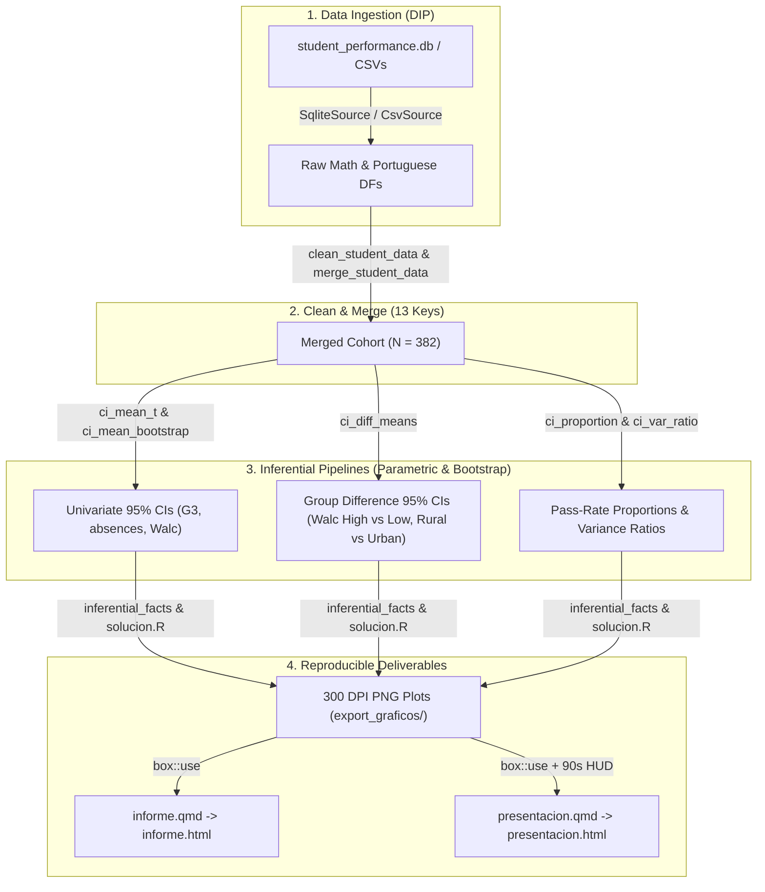

# SDD-03: Unit 3 Confidence Intervals & Bootstrap Specification

This document defines the software architecture and functional requirements for the Unit 3 assignment **'03-intervalos-confianza'** (*Segundo avance del proyecto: Introducción a la inferencia estadística — intervalos de confianza*) in the Master's course "Métodos Estadísticos Avanzados 1".

---

## 1. Context & Scope

Building directly on the Unit 2 descriptive baseline (*Student Performance Dataset*, merged cohort $N = 382$ across Mathematics and Portuguese), Unit 3 transitions from exploratory description to statistical inference using **95% Confidence Intervals (CIs)**. Following the "milla extra" scope, the analysis covers three core variables (`G3` final grades, `absences` school absences, and `Walc` weekend alcohol consumption) plus binary pass rates ($G3 \ge 10$) and residence zone (`address`), contrasting **classical parametric intervals** ($t$-Student, Welch-Satterthwaite, Wald/Wilson proportions, $F$ variance ratio) against **non-parametric Bootstrap intervals** ($B = 5000$ resamples with replacement).

### Pipeline Architecture Workflow

---

## 2. Functional Requirements

### FR-1: Parametric & Non-Parametric Confidence Intervals for the Mean
* **FR-1.1**: The module `app/pipelines/confidence_intervals.R` MUST implement `ci_mean_t(x, conf_level = 0.95)` using the Student's $t$-distribution with $n - 1$ degrees of freedom.
* **FR-1.2**: The module MUST implement `ci_mean_bootstrap(x, conf_level = 0.95, n_boot = 5000L, seed = 2026L)` using vectorized resampling with replacement to compute the non-parametric Percentile Bootstrap CI, bootstrap standard error, and bootstrap bias.
* **FR-1.3**: The module MUST provide `ci_summary_table(data, cols, conf_level = 0.95, n_boot = 5000L, seed = 2026L)` returning a unified `data.frame` comparing parametric $t$-Student and Percentile Bootstrap bounds side-by-side along with sample skewness.

### FR-2: Two-Sample Difference of Means (Welch vs. Bootstrap)
* **FR-2.1**: The function `ci_diff_means(x1, x2, conf_level = 0.95, n_boot = 5000L, seed = 2026L)` MUST compute the 95% CI for $\mu_1 - \mu_2$ using both Welch-Satterthwaite's $t$-approximation (unknown, potentially unequal variances) and two-sample independent Bootstrap resampling.
* **FR-2.2**: The function `ci_paired_diff(x1, x2, conf_level = 0.95, n_boot = 5000L, seed = 2026L)` MUST compute the paired intra-subject difference ($\mu_{\text{por}} - \mu_{\text{mat}}$) via both paired $t$-Student and Bootstrap.

### FR-3: Proportions & Variance Ratio Confidence Intervals
* **FR-3.1**: The function `ci_proportion(k, n, conf_level = 0.95)` MUST compute both the classical Wald normal-approximation CI and the Wilson score CI for a binomial proportion $p$.
* **FR-3.2**: The function `ci_diff_proportions(k1, n1, k2, n2, conf_level = 0.95)` MUST compute the Wald 95% CI for $p_1 - p_2$.
* **FR-3.3**: The function `ci_var_ratio(x1, x2, conf_level = 0.95)` MUST compute the exact $F$-distribution 95% CI for the variance ratio $\sigma_1^2 / \sigma_2^2$ (independent, normal samples only).
* **FR-3.4**: The function `ci_diff_proportions_paired(y1, y2, conf_level = 0.95)` MUST compute the paired Wald CI for $p_1 - p_2$ when both outcomes come from the same subjects (Math vs. Portuguese pass rates).
* **FR-3.5**: The function `ci_var_ratio_paired_boot(x1, x2, conf_level = 0.95, n_boot = 5000L, seed = 2026L)` MUST compute a paired Percentile Bootstrap CI for $\sigma_1^2 / \sigma_2^2$ by resampling subjects jointly (Math vs. Portuguese are paired and non-normal).

### FR-4: Reproducible Report & 150-Second Reveal.js Presentation
* **FR-4.1**: `actividades/03-intervalos-confianza/informe.qmd` MUST dynamically source all statistics from `R/solucion.R` and `app/pipelines/inferential_facts.R` without hardcoding numbers.
* **FR-4.2**: `actividades/03-intervalos-confianza/presentacion.qmd` MUST include `overlay_presentador.html` configured for a strict **150-second (`2:30`)** stopwatch budget (`META_TOTAL_SEG = 150`, `UMBRAL_AMBAR_SEG = 125`, `UMBRAL_ROJO_SEG = 145`). The unit guide states 1:30; the professor authorized 2:30.
* **FR-4.3**: The presentation and speaker guide (`guia_exponente.tex`) MUST cover all 6 rubric elements mandated for the YouTube video deliverable within 150 seconds.

---

## 3. Non-Functional Requirements

* **NFR-1 (Fail-Fast Validation)**: Every exported function MUST validate inputs with `checkmate` assertions.
* **NFR-2 (Determinism)**: All bootstrap functions MUST accept an explicit `seed` (default `2026L`) so results are 100% reproducible across runs.
* **NFR-3 (Code Quality)**: All R and Quarto files MUST pass `styler`, `lintr`, and `testthat` via `Rscript scripts/check.R` with zero warnings or errors.
